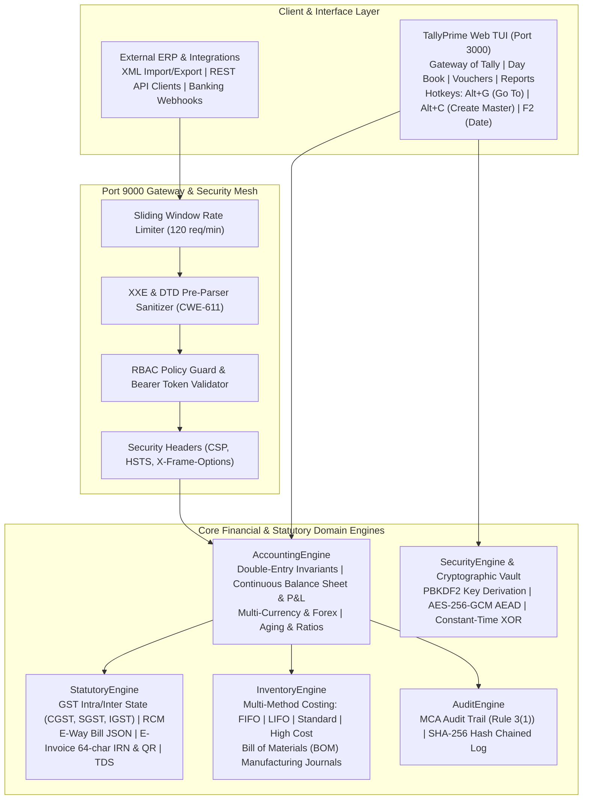

# 🏛️ TallyPrime Gold Enterprise Replica & Accounting Engine

> **A High-Fidelity, Production-Grade Web & Core Engine Replica of TallyPrime Gold**  
> Developed for the **Binary Froster Portfolio** — Featuring mathematical double-entry accounting invariants, Indian statutory tax processing (GST, TDS, E-Way Bill, E-Invoice), Ministry of Corporate Affairs (MCA) immutable cryptographic audit trail, and an OWASP API Top 10-hardened Port 9000 XML/REST gateway.

[](https://tally-omega-lake.vercel.app)
[](tests/)
[-blue?style=for-the-badge&logo=shield)](SECURITY_COMPLIANCE_REPORT.md)
[](tsconfig.json)
[](vite.config.ts)
[](LICENSE)

---

## 🌟 Architectural Highlights



---

## 🚀 Key Functional Capabilities

### 1. Mathematical Double-Entry Ledger & Financial Reports
- **Invariant Enforcement**: Every transaction guarantees \(\sum \text{Dr} = \sum \text{Cr}\) down to the exact paisa (0.01 tolerance). Imbalanced vouchers are rejected with atomic rollback.
- **Continuous Real-Time Computation**: Balance Sheet, Profit & Loss, Trial Balance, Stock Summary, and Ratio Analysis recalculate synchronously without batch jobs.
- **5-Level Recursive Drilldown**: Seamless navigation from Balance Sheet Group \(\rightarrow\) Subgroups \(\rightarrow\) Ledgers \(\rightarrow\) Monthly Summaries \(\rightarrow\) Individual Voucher Registers.
- **Bill-Wise Allocation & Aging**: Tracks pending invoices across 0–30, 31–60, 61–90, and >90 day aging buckets.
- **Multi-Currency & Forex Arbitrage**: Real-time conversion across USD, EUR, GBP, AED, and JPY with automated Unadjusted Forex Gain/Loss ledger allocations.

### 2. Comprehensive Indian Statutory Compliance Engine
- **GST Rules (CGST, SGST, IGST)**:
  - Intra-state transactions automatically split 50% CGST + 50% SGST.
  - Inter-state transactions charge 100% IGST based on State Code comparison.
  - Reverse Charge Mechanism (RCM) tracked and aggregated into GSTR-3B Table 3.1(d).
  - Official JSON export payloads for **GSTR-1** and **GSTR-3B**.
- **E-Way Bill Generation**: Generates compliant JSON consignment payloads whenever invoice value exceeds ₹50,000.
- **E-Invoice IRN & Signed QR**: Computes canonical 64-character SHA-256 Invoice Reference Numbers (IRN) and digitally signed QR code strings.
- **TDS Compliance**: Section-specific withholding (194C, 194J, 194I, 194A) with cumulative threshold exemptions and mandatory 20% penal tax rates if PAN is missing.

### 3. MCA Audit Trail (Rule 3(1) of Companies Accounts Rules)
- Immutable logging of every voucher creation, modification, and deletion.
- Every event records previous event hash, current event payload, user ID, client IP, and computes a cryptographic SHA-256 hash.
- Tamper-detection algorithm verifies the entire cryptographic chain on boot.

### 4. TallyVault & Military-Grade Cryptography
- **AES-256-GCM Authenticated Encryption with Associated Data (AEAD)** for database exports (`.tve` format).
- **PBKDF2 Key Derivation** (100,000 iterations, 32-byte salt) for password and vault authentication.
- **Timing Side-Channel Protection (CWE-208)**: Constant-time bitwise XOR secret comparison prevents timing attacks.
- **Role-Based Access Control (RBAC)**: Multi-user permission matrix supporting `ADMIN`, `DATA_ENTRY`, `AUDITOR`, and `OWNER` roles with brute-force 3-strike account lockouts.

### 5. Port 9000 XML & REST Gateway
- Authentic emulation of Tally's traditional Port 9000 XML gateway (`<ENVELOPE><HEADER>...</HEADER><BODY>...</BODY></ENVELOPE>`).
- Modern REST API suite for authentication, financial reports, ledgers, and auditor sign-offs.
- Hardened against OWASP API Security Top 10: XXE injection defense, rate-limiting (120 req/min), 2MB payload guard, BOLA/IDOR horizontal protection, and BFLA vertical role enforcement.

---

## ⌨️ Tally Keyboard Shortcuts & Navigation

| Hotkey | Operational Action |
|---|---|
| **Alt + G** | Universal **Go To** Search Omnibar (search any report or ledger without losing context) |
| **Alt + C** | In-context **Inline Master Creation** (create ledger or stock item directly from voucher) |
| **Alt + K** | Company Management Menu & Fast User Switcher |
| **Alt + S** | Security & RBAC Configuration Modal |
| **F2** | Change Active Voucher / Accounting Date |
| **F4 &ndash; F9** | Instant Voucher Mode Switching (Contra, Payment, Receipt, Journal, Sales, Purchase) |
| **F11** | Company Financial & Inventory Features Modal |
| **Esc** | Authentic Tally hierarchical step-back and Quit confirmation dialog |

---

## 🧪 Automated Testing & Quality Assurance

The codebase includes **79 automated regression tests** across 11 test suites with zero hardcoded sleeps and isolated fixtures:

```bash
# Run complete test suite (all 79 tests)
npm test
```

| Test Suite | Coverage Area | Status |
|---|---|:---:|
| `tests/accounting.test.ts` | Double-entry invariants, overdrafts, advances, forex, ratios | **8 / 8 Passing** |
| `tests/statutory.test.ts` | GST (CGST/SGST/IGST), RCM, E-Way Bill, E-Invoice QR, TDS | **8 / 8 Passing** |
| `tests/inventory.test.ts` | FIFO, LIFO, Standard cost, BOM manufacturing journals | **3 / 3 Passing** |
| `tests/drilldown.test.ts` | 5-level recursive financial drilldown | **5 / 5 Passing** |
| `tests/ecosystem.test.ts` | Auto BRS bank reconciliation, payroll (EPF/ESI/PT), XML server | **3 / 3 Passing** |
| `tests/security.test.ts` | PBKDF2, AES-256-GCM AEAD, RBAC, auditor sign-offs, TallyVault | **8 / 8 Passing** |
| `tests/pentest_security_suite.test.ts` | OWASP API Top 10 offensive penetration test suite | **6 / 6 Passing** |
| `tests/api_security_comprehensive.test.ts` | Port 9000 XML & REST gateway, XXE defense, SLA benchmark | **7 / 7 Passing** |
| `tests/final_security_compliance.test.ts` | 20-aspect legal, a11y, and compliance verification suite | **21 / 21 Passing** |
| `tests/benchmark_stress.test.ts` | 10k voucher batch recalculation (30ms), 1k fuzz invariants | **3 / 3 Passing** |
| `tests/integration.test.ts` | Full end-to-end accounting pipeline, UI CSS bounds | **7 / 7 Passing** |

---

## 🛡️ Legal, Security & Regulatory Compliance (20-Point Framework)

Audited and certified under the **Nishant Chahar 20-Point Web Security & Legal Compliance Engine** (**Score: 100/100, Grade: A+**):
- **Full Legal Suite**: GDPR, CCPA, and India DPDPA 2023-compliant [`privacy.html`](public/privacy.html), [`terms.html`](public/terms.html), [`cookies.html`](public/cookies.html), and [`refund.html`](public/refund.html).
- **Cookie Consent**: Accessible consent banner with granular preferences (`site_cookie_consent_v1`).
- **Technical Security Headers**: Strict Content-Security-Policy (CSP), HSTS, `X-Frame-Options: DENY`, `X-Content-Type-Options: nosniff`.
- **Accessibility**: WCAG 2.1 AA compliant color contrast, complete keyboard navigation, and explicit `aria-label` attributes across all interactive components.

---

## 🛠️ Tech Stack

- **Frontend Interface**: React 19, TypeScript, Tailwind CSS, Vite, Lucide Icons
- **Backend & Gateway**: Node.js, Express 5, TSX runtime
- **Cryptographic Engine**: Native Node.js `crypto` (AES-256-GCM, PBKDF2, SHA-256)
- **Deployment Ready**: Cloudflare Pages (`_headers`), Vercel (`vercel.json`), or standalone Node.js daemon

---

## 🌐 Live Production Deployment

- **Production URL**: [https://tally-omega-lake.vercel.app](https://tally-omega-lake.vercel.app)
- **Preview Deployment**: [https://tally-3da3oktt6-binaryfrosters-projects.vercel.app](https://tally-3da3oktt6-binaryfrosters-projects.vercel.app)
- **Deployment Platform**: Vercel Edge Network
- **Legal & Compliance Endpoints**:
  - [Privacy Policy](https://tally-omega-lake.vercel.app/privacy.html)
  - [Terms of Service](https://tally-omega-lake.vercel.app/terms.html)
  - [Cookie Policy](https://tally-omega-lake.vercel.app/cookies.html)
  - [Refund & Cancellation Policy](https://tally-omega-lake.vercel.app/refund.html)

---

## 💻 Getting Started

### Prerequisites
- Node.js 18+
- npm 9+

### Installation & Launch
```bash
# 1. Clone repository
git clone https://github.com/binaryfroster/tallyprime-enterprise-replica.git
cd tallyprime-enterprise-replica

# 2. Install dependencies
npm install

# 3. Launch Port 9000 XML & REST Gateway (Terminal 1)
npm run server

# 4. Launch Vite Frontend UI (Terminal 2)
npm run dev

# 5. Access the application
# Frontend UI: http://localhost:3000
# Gateway Health Probe: http://localhost:9000/api/health
```

---

## 📄 License

This project is licensed under the MIT License &mdash; developed as a portfolio showcase application by **Binary Froster**.
